  

### Hi there 👋 I'm xyf

I spent years as a **Java backend developer**, building with Spring Boot, microservices and AI Agents. Now I'm switching tracks to **content creation**, talking about AI tools, tech and the world around us on Bilibili, from a developer's point of view.

- 📺 **Videos**: [My Bilibili channel](https://space.bilibili.com/39728643) (YouTube and more coming) · latest: [I built a music tagging tool with Codex, and Claude didn't stand a chance](https://www.bilibili.com/video/BV19gpw6XEeD/)
- 🧰 **Built**: [Music Tag](https://github.com/xyf527/music-tag) (local music tag manager) · [Enterprise AI Service](https://github.com/xyf527/Enterprise-AI-Service) (RAG / tool calling / multi-agent)
- 🌐 **Website**: [xyf527.github.io](https://xyf527.github.io)
- 📫 **Email**: xyf527725@163.com · xyf1667@gmail.com

The stack I used to code with

 

